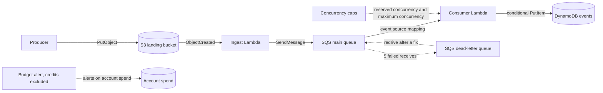
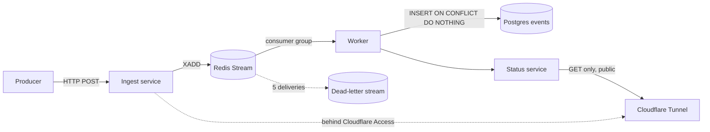

# Event-Driven Serverless Pipeline: Project Overview

One pipeline, two runtimes. Objects land in S3, a Lambda function turns each one
into a queue message, and a second function writes one row per event to
DynamoDB. The same design then runs as a Compose stack under Podman on this
machine (the Kamrui H1), with Redis Streams, a worker, and Postgres. The AWS half
is evidence that gets captured and destroyed. The Compose half stays live.

The AWS account is a free-plan account whose plan ends on 2026-11-05. Everything
that bills there has to be built, measured, captured, and destroyed before that
date. After it, only the Compose half runs, on this machine, and the AWS half is
a record rather than something a reader can apply.

One person builds it, Umbra, one milestone per pull request, with a check that
runs on every push and needs no AWS account.

## The design, and where it came from

The core shape is the obvious one for this problem: an object store as the input,
a queue to absorb bursts, a consumer that can retry one message without failing a
batch, and a table whose key makes a duplicate write a no-op.

| Choice | Why | Rule it follows | Backed or challenged |
|---|---|---|---|
| One Lambda per step, no servers | The pipeline is bursty and mostly idle; there is nothing to patch and nothing to size | Serverless Lens: "prefer managed services", Cost optimization: pay for use | Backed |
| An SQS queue between the two functions | A burst of S3 events would otherwise hit the table at the same rate it hits the bucket; the queue absorbs it and retries on its own | Reliability: "decouple components", "build with retries" | Backed |
| A dead-letter queue with `maxReceiveCount = 5` | A message that fails every time has to stop somewhere a person can read it, instead of cycling forever | Reliability: "capture failures", Operational excellence: "make failures visible" | Backed |
| `ReportBatchItemFailures` on the event source mapping | One bad message must not send nine good ones back to the queue | Reliability: "isolate failures", "design for at-least-once" | Backed |
| A conditional write on `idempotency_key` | SQS delivers at least once, so the consumer will see the same message twice; a condition makes the second write a no-op | Reliability: "make operations idempotent" | Backed |
| A role per function, with named statements | Each function gets exactly the calls its code makes, so a compromised handler cannot read the other's data | Security: "least privilege" | Backed |
| Bucket public access blocked, SSE-S3 encryption | The bucket is an input, never a website; encryption at rest is free here | Security: "encrypt data at rest" | Backed |
| Log groups made by Terraform, 14-day retention | A log group Terraform owns dies with the stack, and 14 days is long enough to debug a burst that lasts an hour | Operational excellence: "instrument for observability", Cost optimization: "manage demand and supply" | Backed for ownership, challenged on 14 days: a long-lived stack would keep 90 |
| An alert-only budget at 1 USD, credits excluded | An alert, not a limit: it reports spend with up to a day's delay, so the only same-day bounds are the mapping cap and the destroy in SP14 | Cost optimization: "manage cost with budgets and alerts" | Backed |
| `maximum_concurrency` on the mapping | Throttling at the queue is the cap that keeps a burst from consuming the account's whole concurrency | Reliability: "use back pressure", Performance efficiency: "use concurrency controls" | Backed |
| Reserved concurrency as a variable that defaults to off | The account Lambda limit is 10, and AWS requires 100 unreserved units before any reservation, so an apply with a positive value fails | Reliability: "throttle to protect" | Challenged, and left as a **decision for you**: raise the quota to 1000 and set a positive value, or keep the mapping cap and the budget as the bounds and record the amendment. SP8 states both routes |
| One standard queue, not FIFO | Order is not part of the contract; the key makes a duplicate harmless, which is the property FIFO would otherwise buy | Reliability: "design for at-least-once" | Challenged: FIFO would remove the duplicate-delivery exercise this project exists to demonstrate |
| Node 24 TypeScript on `arm64` | One toolchain builds both functions, and `arm64` is cheaper per GB-second | Performance efficiency: "use the right resources" | Backed |
| OpenTofu with S3 native locking | State is remote, locked, and versioned, so two runs cannot corrupt it | Operational excellence: "manage infrastructure as code" | Backed |
| OIDC from the CI provider instead of access keys | No long-lived credential exists to leak, and the trust policy names one repo and two contexts | Security: "use temporary credentials" | Backed |
| The Compose port of the same design | After the AWS stack is destroyed there is nothing to demo; the Compose stack is the permanent, zero-cost version | Cost optimization: "decommission unused resources" | Backed |
| A public read-only status hostname, writes behind Access | A login wall is not a demo, and a write path should not be public | Security: "implement a strong identity foundation" | Backed |

## How it works

Solid arrows are the flow. Dotted arrows are failures and returns. The AWS
runtime:

The budget watches the account's spend, not one resource: it knows nothing about the bucket, and a credit that hides a charge hides it from the budget too. That is why the same-day bounds are the mapping cap and the destroy rather than the alarm.

The Compose runtime:

1. An object lands in the landing bucket.
2. S3 invokes the ingest function once per object.
3. The ingest function reads the object, adds `landedAt` from the event, settles
   the idempotency key, and sends one message.
4. The event source mapping hands messages to the consumer, ten at a time.
5. The consumer writes a row with a conditional put; an existing key counts as
   success.
6. A message that fails five receives moves to the dead-letter queue, and
   `scripts/redrive.sh` moves it back after the fix.

The Compose runtime keeps the same six steps with different products: Redis
Streams for the queue, a consumer group for the mapping, `ON CONFLICT DO
NOTHING` for the conditional put, a dead-letter stream for the DLQ, and a
delivery count in the pending list for `maxReceiveCount`.

## Shared contracts

Every milestone builds against these. Change one only on purpose, and say why in
the decision log.

**Names.** Every resource is `<name_prefix>-<role>`: `<prefix>-main`,
`<prefix>-dlq`, `<prefix>-events`, `<prefix>-landing-<account id>`,
`<prefix>-ingest`, `<prefix>-consumer`, `<prefix>-guard`. Log groups are
`/aws/lambda/<prefix>-<role>`. The default prefix is `serverless-pipeline`; the
tests use `demo` on purpose, so a typed-in name fails.

**The message** (ingest function to queue to consumer):

| Field | Type | Set by | First appears | Meaning |
|---|---|---|---|---|
| the object's own fields | any | the producer | SP6 | carried unchanged |
| `landedAt` | ISO 8601 string | the ingest function, from the S3 record's `eventTime` | SP6 | the clock start for the benchmark |
| `idempotencyKey` | string | the ingest function, once: the body's value when it has one, otherwise the decoded object key | SP9 | the value the conditional write checks |

SP6 deliberately sends the message without `idempotencyKey`. The field arrives in
SP9, together with the conditional write that reads it, because the key and the
write are one decision: a key chosen without the write in view is a guess that
SP9 then has to change.

Re-uploading the same bytes to the same key is the same event. The same bytes
under a different key is a different event. The duplicate test in SP12 re-uploads
to the same key for exactly this reason.

**The row** in DynamoDB:

| Attribute | Type | Set by |
|---|---|---|
| `idempotency_key` (partition key) | string | the consumer, from the message |
| `payload` | string, the message body verbatim | the consumer |
| `processed_at` | string, ISO 8601 | the consumer |

**Handler interfaces.** Both handlers are built by a factory, so the tests can
pass stub clients and no test ever needs an AWS account.

| File | Export | Takes | Returns |
|---|---|---|---|
| `src/ingest/handler.ts` | `createHandler(deps)` | `getObject(bucket, key): Promise<string>`, `sendMessage(body): Promise<void>` | a handler for `{ Records: [...] }` that returns `{ sent }` |
| `src/consumer/handler.ts` | `createHandler(deps)` and `DuplicateEventError` | `writeRow({ idempotencyKey, payload, processedAt }): Promise<void>`, `now(): string` | a handler for `{ Records: [...] }` that returns `{ batchItemFailures }` |

A `writeRow` that rejects with `DuplicateEventError`, or with an error whose
`name` is `ConditionalCheckFailedException`, means the row was already written.
That is success, and the message is not reported as failed.

**Outputs.** `landing_bucket`, `main_queue_url`, `main_queue_arn`, `dlq_url`,
`dlq_arn`, `table_name`, `ingest_function_name`, `consumer_function_name`. Each
arrives in the milestone that builds the resource, and never changes name.

**The Compose port** uses the same two timestamps and the same key: `xAdd` writes
`idempotencyKey`, `payload`, and `landedAt`; the worker inserts `idempotency_key`,
`payload`, `landed_at`, and `processed_at`, the last defaulting to `now()`. The
latency is `processed_at` minus the landing time on both runtimes: on AWS the
landing time travels inside the stored payload, on Compose it is its own column.
Same definition, two storage shapes, and SP13 reads each one from where it is.

## The milestones

One sitting each. The order is the order to build them.

| ID | What it builds | Branch | Depends on | Spends money |
|---|---|---|---|---|
| SP0 | The public repository, made by OpenTofu, and the scaffold every later milestone writes into | `sp0-repo` | nothing | no |
| SP1 | AWS access: the session you can prove, the account number, the first registration | `sp1-aws` | SP0 | no |
| SP2 | State bucket, created by a bootstrap config that then moves its own state into it | `sp2-state` | SP1 | no |
| SP3 | OIDC provider, CI plan role, and the throwaway workflow that proves it | `sp3-oidc` | SP2 | no |
| SP4 | The CI skeleton: the static job, the plan job, the badge | `sp4-ci` | SP3 | no |
| SP5 | Queue, dead-letter queue, and table | `sp5-queues` | SP4 | no |
| SP6 | Landing bucket, S3 trigger, ingest function | `sp6-ingest` | SP5 | no |
| SP7 | Consumer function and event source mapping | `sp7-consumer` | SP6 | no |
| SP8 | Blast-radius caps: budget, mapping cap, and the per-function setting (off by default, your decision) | `sp8-caps` | SP7 | no |
| SP9 | Idempotent writes and partial batch failures | `sp9-idempotency` | SP8 | no |
| SP10 | The Compose runtime: worker, stream, store | `sp10-compose` | SP9 | no |
| SP11 | The public read-only status view | `sp11-status` | SP10 | no |
| SP12 | First apply and the failure drill | `sp12-drill` | SP11 | yes |
| SP13 | Benchmark both runtimes | `sp13-benchmark` | SP12 | yes |
| SP14 | Destroy and evidence | `sp14-destroy` | SP13 | stops |
| SP15 | README, published policy, decision log | `sp15-readme` | SP14 | no |
| SHIP | Ship: the scaffolding leaves, the README is rewritten for a stranger, the license and the normal CI land | `ship` | SP15 | no |

SP10 sits before SP12 on purpose. The benchmark has to run while the AWS stack is
still applied, and the Compose half has to exist before that, so the Compose
runtime is built first and the money starts afterwards. SP10 and SP11 run on this
machine and cost nothing; SP12 to SP14 run in the account whose plan ends on
2026-11-05.

SHIP is last and has no number, because it is always last and how many milestones
come before it differs by project. It adds no product code: it removes what a
reader has no use for and makes the README do the work a finished repository has
to do.

## The 2026-11-05 deadline

The free-plan account that holds the AWS half ends its plan on 2026-11-05. AWS
suspends the account and keeps its data for 90 days, and upgrading to a paid plan
inside that window reopens it; this project destroys and captures instead of
paying, so the date splits the project by lifetime, not by machine:

- The setup milestones, SP1 to SP3 (the AWS session, the state bucket, and the OIDC role), have to
  be built while the plan runs. Rebuilding them after it ends means paying for the upgrade.

- The burst milestones, SP12 to SP14 (the first apply, the drill, the benchmark,
  the destroy, and the evidence), have to be finished and captured before the
  date. The drill and the benchmark need a live account, and the destroy has to
  be confirmed while the services still answer.

- The permanent milestones, SP10 and SP11 (the Compose stack and the status page
  on this machine, the Kamrui H1), keep running after the account is gone. They
  are what a reader can still open.

SP4 to SP9 spend nothing, so the date does not threaten them. They only have to
land before the burst can start.

**What stops working when the plan ends.**

- The CI `plan` job. It exchanges `id-token` for a session with the role SP3
  created, and that role and its provider live in the account, so the job fails
  at the assume step. The `static` job and `milestone-check.yml` keep working,
  because neither needs an account.

- The remote state. `terraform/` points at the bucket SP2 created, so `tofu init`
  there fails and every local plan fails with it. The bootstrap folder is in the
  same position, which also means the role cannot be recreated.

- `scripts/check-destroyed.sh`, the budget, and every other question asked of a
  service.

**Before 2026-11-05, all four of these are true.**

- [ ] The final CI run is green, and the README links that run.

- [ ] `evidence/` is committed, and the failure capture is a Release asset.

- [ ] `scripts/check-destroyed.sh` reports nothing left, and `evidence/destroy.log`
  is committed.

- [ ] The README states the AWS half is evidence only, and does not claim that a
  reader can apply it.

**What the README claims instead.** "What you can verify yourself" keeps the
clickable checks: the badge, the URL of the last green run, the `static` job, the
trust policy, and the live status page. The AWS paragraphs say the stack was
applied, measured, captured, and destroyed before the plan ends. They do not
invite a reader to run `tofu apply` against state that no longer exists, and they
do not describe the
`plan` job as currently green.

### Milestones the date threatens

| Milestone | Why the date matters |
|---|---|
| SP2, SP3 | The bucket and the role cannot be created after the plan ends, and SP4's plan job needs the role |
| SP12 | The first apply has to happen before the date; a drill run afterwards has no account to drill in |
| SP13 | The AWS column is measurable only while the stack is applied and the account is open |
| SP14 | The destroy and its confirmation are the last actions the account allows |
| SP15 | The README's claims change with the date, so it is written after the destroy and says so |

## If you start after 2026-11-05

The guide is written to be built before that date, and a reader who finds it later cannot follow it exactly. Nothing technical stops them. This is the path:

- **SP0 to SP9 work unchanged.** They need no AWS spend, and SP4 to SP9 are plan-only, so a paid account on the smallest possible footprint runs them for cents. The sign-in steps in SP1 are the same.
- **SP12 to SP14 become optional.** The first apply, the drill, the destroy, and the AWS evidence column need a live account. Without one, skip those three milestones and their checks, and say in the README that the AWS half was not run.
- **SP10, SP11, and SP13's Compose column work as written.** They run on the machine, cost nothing, and produce the numbers the README's Compose column needs.
- **SP15 and SHIP keep their shape.** The README states the Compose half as the live demo and the AWS half as a design that was not deployed. The ship check still passes: it reads files, not accounts.
- **One time budget to plan with.** SP2, SP3, SP5, SP6, and SP7 take an evening each; SP12 needs about 15 minutes of enforced waiting plus the drill; SP13 needs the next day for Cost Explorer's figures. Ten days is comfortable, two is not.

If the plan has already ended, AWS suspends the account and keeps the data for 90 days, and upgrading to a paid plan inside that window reopens it: that is the route back for a reader who wants the AWS half as well. This project does not take it, and the evidence is the record instead.

## Definition of done, mapped

Each line of this project's definition of done, and the milestone that closes it.
Nothing is left without an owner.

| Definition-of-done line | Closed by |
|---|---|
| Architecture diagram, both runtimes | This overview, and the README in SP15 |
| CI badge and a linked green run in the README (fmt, validate, tflint, checkov, plan over OIDC and remote state) | The badge in SP4; the run URL in SP15, because the run that matters is the last one, after every milestone has landed |
| IAM policy published: the policy JSON plus the action-to-reason table | SP15 |
| AWS burst: a 60 to 90 second capture of the failure path, then one event replayed twice with a single row | SP12 |
| Benchmark table, both runtimes, 1,000 events, taken while AWS was live | SP13 |
| AWS burst destroyed the day the evidence was captured, `evidence/` populated | SP14 |
| Every AWS-billing milestone finished, captured, and destroyed before 2026-11-05 | SP14, and the checklist above |
| The Compose port live on this machine (the Kamrui H1), a public read-only hostname, writes behind Access | SP11 |
| The README states the "why this can't run away" line, with what the caps did to the dead-letter queue | SP15, from the SP8 cap and the SP12 measurement |
| The README's "What you can verify yourself" section | SP15 |
| The decision log, filled in as the work happens | Started in SP4, published in SP15 |
| The repository is public from its first commit, and nothing secret is in it | SP0, and the push protection SP0 turns on |
| A stranger can answer what it is, how it works, what proves it, and what it traded away, and the build scaffolding is gone | SHIP, from the SP15 README |

## Sources

| Source | What it settles |
|---|---|
| [AWS Well-Architected Framework: the pillars](https://docs.aws.amazon.com/wellarchitected/latest/framework/the-pillars-of-the-framework.html) | The six pillars named in the design table |
| [Serverless Applications Lens](https://docs.aws.amazon.com/wellarchitected/latest/serverless-applications-lens/welcome.html) | The serverless-specific principles, such as preferring managed services |
| [Event source mappings](https://docs.aws.amazon.com/lambda/latest/dg/invocation-eventsourcemapping.html) | How the queue feeds the consumer, and what partial-batch reporting needs |
| [SQS dead-letter queues](https://docs.aws.amazon.com/AWSSimpleQueueService/latest/SQSDeveloperGuide/sqs-dead-letter-queues.html) | The redrive policy and `maxReceiveCount` |
| [DynamoDB conditional writes](https://docs.aws.amazon.com/amazondynamodb/latest/developerguide/WorkingWithItems.html) | The condition that makes a duplicate write a no-op |
| [S3 event notifications](https://docs.aws.amazon.com/AmazonS3/latest/userguide/EventNotifications.html) | The notification that invokes the ingest function |
| [OpenTofu S3 backend](https://opentofu.org/docs/language/settings/backends/s3/) | Remote state and native locking |
